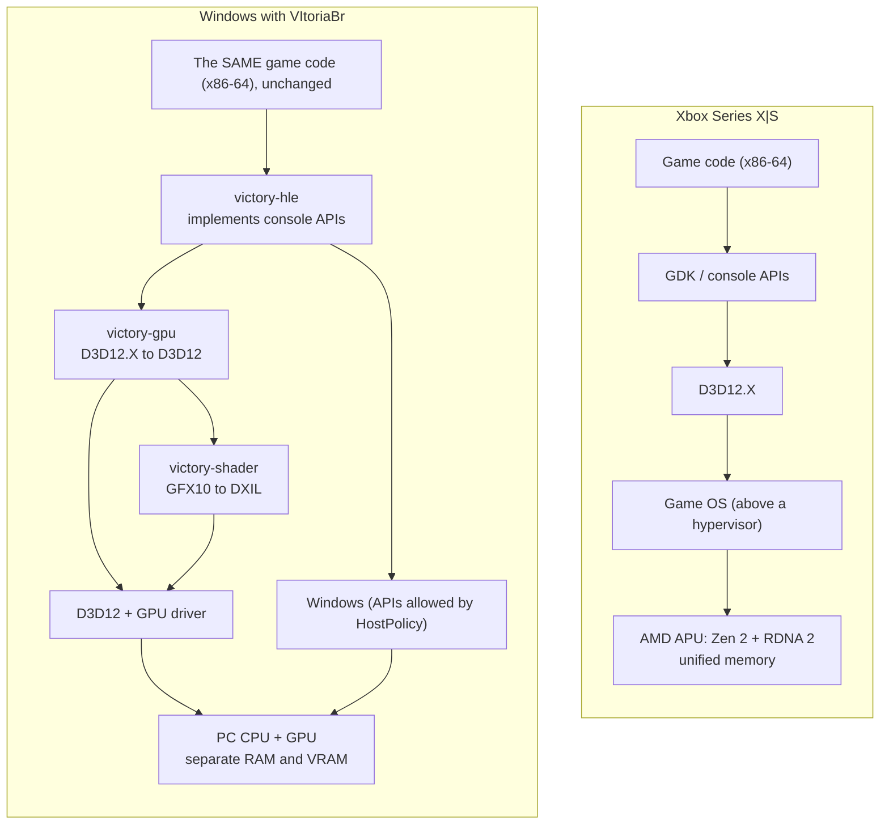
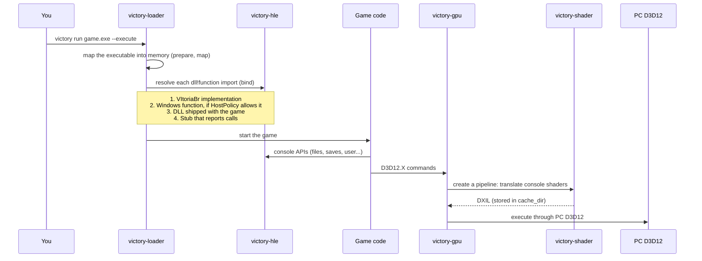
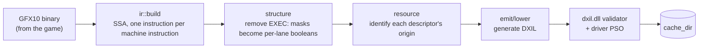
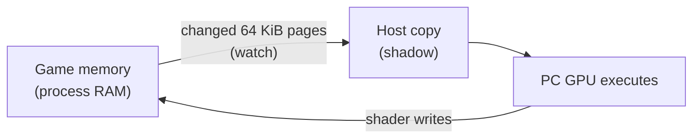

# Overview: how VItoriaBr runs an Xbox game on a PC

This document explains, without assuming GPU knowledge, **why an Xbox Series X|S game
cannot run directly on Windows** and **what each part of VItoriaBr does to address this**.
For technical details of each component, see [architecture.md](architecture.md). Current status
and measurements are in the [README](../README.md).

> Nothing here contains game data. See the [asset policy](asset-policy.md).

---

## 1. The starting point: similar hardware, different software

Xbox Series X and modern PCs use the same CPU architecture (x86-64, with AMD Zen 2 in the console).
This means the **game's CPU code runs unchanged** inside the VItoriaBr process. This is not
CPU emulation of the kind used for older consoles.

Everything else prevents the game from running:

| Barrier | On Xbox | On PC | VItoriaBr component responsible |
|---|---|---|---|
| Console system and APIs | Game OS + GDK (`xgameruntime.dll`, saves, accounts, storage) | Unavailable | `victory-loader` + `victory-hle` |
| Graphics API | D3D12.X, with commands recorded directly by the game | Standard D3D12 | `victory-gpu` |
| Shaders | Already compiled for the console GPU (GFX10 / RDNA 2 ISA) | The PC GPU expects DXIL | `victory-shader` |
| Memory | Unified: GPU address = CPU address | Separate RAM and VRAM | `victory-gpu` (copies, `shadow`, `memory`) |
| Data formats | Custom texture layouts, hardware-decompressed BCPack, XMA audio | No native support | `victory-formats` |
| Wave size | 64 or 32 lanes, depending on the program | NVIDIA: always 32 | `victory-shader` (partial support for whole-wave sections) |
| Ray tracing | Compute traversal + one hardware instruction per node | That instruction is unavailable | `victory-shader` (instruction emulated in DXIL; work in progress) |

---

## 2. The stack: original Xbox versus VItoriaBr on PC



The central idea: **the game still thinks it is running on an Xbox.** Every call it makes
to the "console" reaches a VItoriaBr implementation that performs the equivalent work on Windows.

---

## 3. What happens when you run `victory run ... --execute`



Important details:

- **Import resolution** (`victory-loader` + `victory-hle`) is the heart of compatibility. If the
  game requests an unimplemented function, it receives a *stub* that logs the name. This makes
  missing functionality easy to identify (`victory census` reports it without running the game).
- **Files and saves:** the game uses paths on console "drives". `victory-hle::modules::files`
  rewrites these paths to PC directories; saves are stored in `VICTORY_DATA_DIR`.
- **Online functionality:** online APIs respond as an offline console would.
- **GPU commands:** on the console, the game writes packets directly into the command list.
  VItoriaBr keeps those lists' limit at zero, so **every command becomes a function call** that it
  intercepts and executes through D3D12.

---

## 4. Shaders: why this is the hardest part

On PC, a game supplies DXIL shaders, which the driver compiles for the specific GPU. Console shaders
are already **compiled into binaries for the Xbox's AMD GPU**. VItoriaBr must translate those
binaries back into DXIL **when the game creates each pipeline**:



Three things make this difficult:

1. **EXEC and lanes.** The AMD GPU uses an EXEC mask to control which lanes (threads) are active.
   DXIL has no equivalent concept, so control flow must be reconstructed (`structure`).
2. **Wave64 versus wave32.** Many console programs run in 64-lane waves. NVIDIA GPUs only have 32.
   Reductions and prefix sums performed in whole-wave sections are simulated and rewritten using
   DXIL wave operations (`emit/wave.rs`). Compute shaders that truly require wave64 are still
   rejected by NVIDIA and account for most missing PSOs (see the README).
3. **Instructions without equivalents.** For example, ray-versus-BVH-node testing
   (`image_bvh*_intersect_ray`) is a hardware instruction on the console. VItoriaBr emulates it in
   DXIL and compares it against a Rust reference (`crates/victory-shader/src/bvh.rs`).
   See [fork-ray-tracing.md](fork-ray-tracing.md).

---

## 5. Unified memory: why the 3D world is still slow

On the console, CPU and GPU read the same memory: **a GPU address is a CPU address**. On PC, the GPU
cannot directly read the game process's memory, so VItoriaBr maintains **copies**:



- Every buffer used by a draw receives a host copy (`shadow.rs`). Before each submission, only the
  64 KiB pages modified by the game are copied again (`watch.rs`).
- Shader writes are copied back to game memory after submission.
- Shaders following raw 40-bit pointers use a directory with one entry per 64 KiB page (`memory.rs`).
- The **relay** (`VICTORY_RELAY=1/2`) uses a separate thread to copy results back while the next
  submission is prepared.

The console never needs this round trip. It is one reason the 3D world still runs at only a few fps.

---

## 6. Crate map

| Crate | Summary | Runs/tests on Linux? |
|---|---|---|
| `victory-core` | Configuration, asset-policy guard, logging | Yes |
| `victory-pe` | Reads PE32+ executables | Yes (tests using the binary itself require Windows) |
| `victory-loader` | Loads, maps, binds, and starts the game | No |
| `victory-hle` | Implements console APIs | No |
| `victory-gpu` | D3D12.X on top of PC D3D12 | No |
| `victory-shader` | Translates console shaders into DXIL | Yes (validation and GPU use require Windows) |
| `victory-formats` | Texture layouts, BCPack, audio | Yes |
| `victory-pipeline` | Content-addressed cache | Yes |
| `victory-game` | Title-specific formats and hooks | Yes |
| `apps/victory` | Command-line interface | No |
| `xtask` | Asset-policy checks, Git hooks | Yes |

---

## 7. How to contribute

**Without Windows** (Linux or macOS), the crates marked "Yes" above build and test outside Windows.
This is the same set used by the CI `portable` job:

```sh
cargo test -p victory-core -p victory-pe -p victory-pipeline -p victory-shader \
           -p victory-formats -p victory-game -p xtask
```

This lets you work on the shader translator (`victory-shader`), formats, and cache. Tests requiring
the `dxil.dll` validator or a GPU are excluded and run in the Windows job.

**On Windows**, follow the README (`cargo build --profile diag -p victory --features diagnostics`).
Use `VICTORY_D3D12_WARP=1` to test the 3D world without risking a GPU-driver TDR, and
`victory translate --validate --pipelines` to measure shader coverage.

Before any commit, run `cargo xtask policy` (or install the hooks with `cargo xtask install-hooks`).

---

## Glossary

| Term | Meaning |
|---|---|
| **APU** | CPU and GPU on the same chip, sharing memory (as on Xbox) |
| **GDK** | Microsoft's development kit for Xbox and PC |
| **D3D12.X** | Xbox-specific version of Direct3D 12 |
| **HLE** | *High-Level Emulation*: implementing system APIs instead of emulating hardware |
| **GFX10 / RDNA 2** | Xbox Series GPU architecture and instruction set |
| **DXIL** | Shader format accepted by PC Direct3D 12 |
| **PSO** | *Pipeline State Object*: shaders and state compiled by the driver |
| **Wave / lane** | A group of threads executed together by the GPU (wave), and each individual thread (lane) |
| **EXEC** | AMD GPU mask specifying which lanes are active |
| **TDR** | Windows restarting the display driver after the GPU stalls for more than ~2 seconds |
| **WARP** | Software D3D12 implementation (slow, but does not hang the GPU driver) |
| **BVH** | Tree structure used to accelerate ray tracing |
| **BCPack** | Texture compression decompressed in hardware by Xbox |
